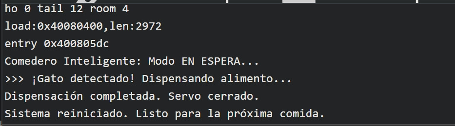

# Comedero Inteligente para Gatos 
  
Proyecto del curso EL-1200 Introducción a la Electrónica, TEC, II semestre 2026. 
  
**Integrante:** Danna Paola Mora Mora
  
## Descripción 
Comedero automático que dispensa alimento solo cuando detecta al gato y evita servir de más si el gato se queda frente al plato. 
  
## Funcionamiento 
- El sensor PIR detecta la presencia del gato.
- El servomotor abre la compuerta 1,5 s y la vuelve a cerrar.
- El LED indica que se está sirviendo.
- Una variable booleana (dispensado) evita que se sirva otra vez mientras el gato sigue ahí. 
  
## Conexiones
| Componente      | Pin del ESP32 | 
|-----------------|---------------| 
| Sensor PIR      | GPIO 2        | 
| Servomotor      | GPIO 13       | 
| LED (con 220 Ω) | GPIO 5        | 
| Alimentación    | 3V3 y GND     | 
  
 
  
## Simulación 
Proyecto en Wokwi: [<enlace público> ](https://wokwi.com/projects/480798823826741249)
  
## Código 
Ver la carpeta firmware/. Biblioteca usada: ESP32Servo. 
  
## Evidencia 
 

  
## Mejoras futuras - <una o dos ideas: horarios, sensor de nivel, aviso por Wi-Fi...>
