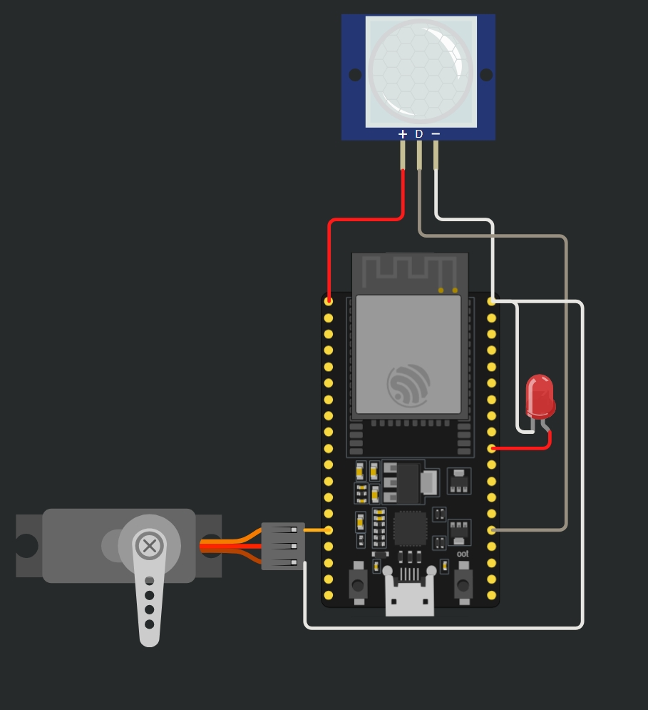

# Comedero Inteligente para Gatos

Proyecto del curso **EL-1200 Introducción a la Electrónica**  
Instituto Tecnológico de Costa Rica · II semestre 2026

**Integrante:** Danna Paola Mora Mora

---

## Descripción

Comedero automático que dispensa alimento únicamente cuando detecta la presencia del gato.  
Incluye una lógica de control que evita servir de más si el animal se queda frente al plato.

---

## Funcionamiento

- El **sensor PIR** detecta la presencia del gato.
- El **servomotor** abre la compuerta durante 1.5 segundos y luego la cierra.
- El **LED** se enciende para indicar que se está dispensando alimento.
- Una variable booleana (`dispensado`) evita que se sirva nuevamente mientras el gato permanece frente al sensor.

---

## Conexiones

| Componente          | Pin del ESP32 |
|---------------------|---------------|
| Sensor PIR          | GPIO 2        |
| Servomotor          | GPIO 13       |
| LED (con 220 Ω)     | GPIO 5        |
| Alimentación        | 3V3 y GND     |

---

## Simulación

Proyecto en Wokwi:  
[Ver simulación completa](https://wokwi.com/projects/480798823826741249)

---

## Código

El código completo se encuentra en la carpeta [`firmware/`](firmware/).

**Biblioteca utilizada:** `ESP32Servo`

---

## Evidencia

### Captura de la simulación

### Video de funcionamiento
[]

---

## Mejoras futuras

- Agregar control por horarios programados.
- Incorporar un sensor de nivel para detectar cuando el alimento se está acabando.
- Enviar notificaciones por Wi-Fi cuando se dispense comida.
